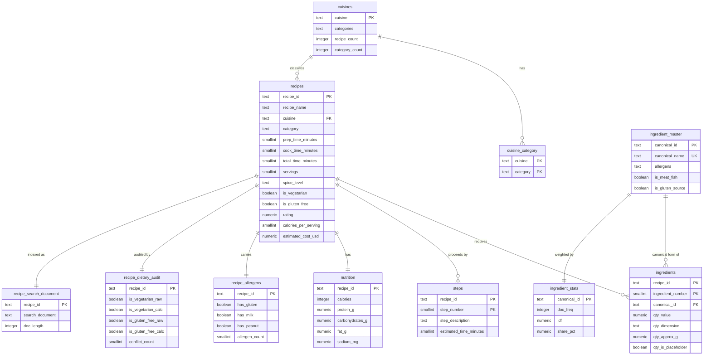

# Schema design: ER model, normalisation and denormalisation

Version **v1.0**, frozen 2026-11-18 (schema freeze announced in the project
issue). Every performance number in the report is measured against this version.
Column names are the contract published in `part_a/docs/handoff.md` and cannot
be changed without a written change record (see §7).

## 1. Entities and grain

| # | Table | Grain (one row per ...) | Rows | Key |
|---|---|---|---:|---|
| 1 | `cuisines` | cuisine | 5 | `cuisine` |
| 2 | `cuisine_category` | cuisine x category | 25 | `(cuisine, category)` |
| 3 | `recipes` | recipe | 9,997 | `recipe_id` |
| 4 | `ingredient_master` | canonical ingredient | 57 | `canonical_id` |
| 5 | `ingredients` | recipe x canonical ingredient | 95,912 | `(recipe_id, ingredient_number)` |
| 6 | `steps` | recipe x step | 84,616 | `(recipe_id, step_number)` |
| 7 | `nutrition` | recipe | 9,997 | `recipe_id` (1:1) |
| 8 | `recipe_allergens` | recipe | 9,997 | `recipe_id` (1:1) |
| 9 | `recipe_dietary_audit` | recipe | 9,997 | `recipe_id` (1:1) |
| 10 | `ingredient_stats` | canonical ingredient | 57 | `canonical_id` |
| 11 | `recipe_search_document` | recipe | 9,997 | `recipe_id` (1:1) |

Tables 7-9 and 11 are vertical partitions of the recipe entity, not separate
concepts: they exist because their attributes are written by different pipeline
stages, are consumed by different queries, and (for `recipe_search_document`)
would otherwise make the hot table four times wider. Splitting them keeps
`recipes` at 1.7 MB, which is what makes the q2 sequential scan cheap.

## 2. ER diagram

Cardinalities: `||--o{` is one-to-zero-or-many, `||--||` is exactly one-to-one.
All eleven tables appear with their key attributes (the full column list is
`sql/schema.sql`; the diagram keeps only what a reader needs to follow a join).
The two links to `ingredient_master` are why q1 can weight a match without
touching the 95,912-row fact table twice.

The diagram is Mermaid source, so it renders in the README/VS Code preview and
on GitHub without an extra file; for the PDF report export it with
`npx @mermaid-js/mermaid-cli -i docs/schema-design.md -o schema.png` (needs a
one-off `npm install`). `docs/evidence/er_attribute_check.txt` records the check
that every attribute drawn here exists as a column in `recipe_db`.

## 3. Functional dependencies and 3NF

For each relation, the left side is the key and the right side is every
non-key attribute:

| Table | Functional dependency | Verdict |
|---|---|---|
| `cuisines` | `cuisine -> recipe_count, category_count` | 3NF (single-attribute key, no transitive dependency) |
| `cuisine_category` | `(cuisine, category) -> {}` | 3NF (all-key relation, encodes the M:N relation) |
| `recipes` | `recipe_id -> {35 attributes}` | 3NF (everything depends on the whole key, nothing else) |
| `ingredient_master` | `canonical_id -> canonical_name, category, allergens, is_animal, is_meat_fish, is_gluten_source, note` | 3NF; `canonical_name -> canonical_id` also holds, both are candidate keys, the surrogate is chosen |
| `ingredients` | `(recipe_id, ingredient_number) -> {quantity fields, canonical_id, merged_row_count, ...}` | 3NF; `canonical_id -> category` would be a transitive dependency, which is why category, allergens and the meat flags live in `ingredient_master` |
| `steps` | `(recipe_id, step_number) -> step_description, estimated_time_minutes` | 3NF |
| `nutrition` | `recipe_id -> {11 nutrient values}` | 3NF |
| `recipe_allergens` | `recipe_id -> {10 flags, allergens, allergen_count}` | 3NF |
| `recipe_dietary_audit` | `recipe_id -> {raw flags, calc flags, proxy, conflicts}` | 3NF |
| `ingredient_stats` | `canonical_id -> doc_freq, total_recipes, idf, idf_norm, rarity_rank, avg_approx_g, share_pct` | 3NF; `doc_freq -> idf` is a derived dependency, not a partial one (see §4) |
| `recipe_search_document` | `recipe_id -> search_document, doc_length` | 3NF formally, but deliberately derived (§4) |

The step that actually creates the design is `ingredients`. Keeping the raw
source shape (one flat table with ingredient names typed as text) would make
`ingredient_name -> ingredient_category, allergens, is_meat_fish` a transitive
dependency, and would store the same 57 ingredient facts 95,912 times: renaming
"Curry Leaves" or correcting its allergen list would mean rewriting the whole
fact table, and nothing would stop "tomato" and "Tomato" from coexisting.
Normalising to `ingredient_master` + `ingredients` makes those 57 rows the single
source of truth and turns "which recipes use tomatoes" into an index probe on a
short `text` key instead of a `LIKE '%tomato%'` scan.

## 4. Deliberate denormalisation (and what it costs)

| Where | Redundant data | Why | Price paid |
|---|---|---|---|
| `recipes` | `ingredient_count`, `step_count`, `allergen_count`, `estimated_total_g`, `estimated_g_per_serving`, `calories_per_serving` | q1 and q2 need counts and totals while filtering and sorting; aggregating 95,912 lines per request would dominate both queries | must stay consistent with the child tables; verified after every load (0 disagreements, `docs/load_verification.md` §3) |
| `recipes` | `is_*_raw` next to the recomputed `is_*` | the 3,259 / 1,740 / 5,863 disagreements are a finding of the project, not an error to hide | four extra boolean columns |
| `cuisines` | `categories` (comma-separated list) | comes straight from the source and is used for display only | violates 1NF, so it is duplicated into `cuisine_category`; the column is never filtered on |
| `ingredients` | `canonical_name` | the API returns ingredient names for one recipe (<= 20 rows), so joining 57 rows to get them buys nothing | a renamed canonical name must be re-rendered from `ingredient_master`; joins always use `canonical_id` |
| `ingredient_stats` | `doc_freq`, `idf`, `share_pct` | derived from `ingredients`, but q1 needs them on every call and they are identical for all recipes | recomputed by the ETL for every scale tier (salt/onion/garlic = 1.0, tomato = 3.7378 on the 10k tier) |
| `recipe_search_document` | concatenated text, `doc_length` | one GIN index instead of joining four tables at query time | ~5 MB extra plus an ETL step; must be regenerated when an ingredient line changes |

`recipe_allergens` looks like a 1NF violation but is not: the ten `has_*` columns
are ten *different* attributes (different classes, different meanings), not ten
values of one attribute. The `allergens` text column beside them is the
denormalised one - it is the display string - while q2 filters on `has_*`, and a
`CHECK` keeps `allergen_count` equal to the number of true flags.

The counter-example to quote in the report: a single flat `recipe` table with a
comma-separated ingredient list would answer q3 with a `LIKE` scan, could not
answer q1 at all without parsing strings at query time, and could not enforce that
a recipe's allergen flags match its ingredients. That is the price of the 3NF
design: 11 tables and a join per query, paid once, in exchange for correctness
that the constraints can actually enforce.

## 5. Index rationale, one line each

| Index | Query | One-line reason |
|---|---|---|
| `idx_ingredients_canonical` | q1 | q1 enters through the ingredient dimension; `INCLUDE (recipe_id)` keeps the lookup index-only. It stops reading a 293 MB heap at x20, which saves 91 ms per call (1.3×) there; at x1 the heap is small enough to scan and it is a tie |
| `idx_recipes_cuisine_category_time` | q2 | the two equality filters must lead, the time range follows, display columns ride along in `INCLUDE` |
| `idx_recipes_veg_gf_time` | q2 | the dietary filter matches ~17% of recipes, so a partial index stores only those rows, already ordered by time |
| `idx_search_document_fts` | q3 | `@@` lookups are what GIN exists for; the indexed expression must be repeated verbatim in the query or the index is ignored |

Measured effect and the plan shapes are in `docs/load_verification.md` §6-7.

## 6. Integrity model

- 10 foreign keys, all `DEFERRABLE INITIALLY DEFERRED`: Part A's loader copies
  parents after children inside one transaction, so deferred checking is a
  requirement, not a preference. It is also what keeps a full reload at 1.7 s
  instead of one FK probe per row.
- 56 `CHECK` constraints carry the domain knowledge: recomputed vs raw dietary
  flags, `total_time = prep + cook`, `spice_level` in four values, a placeholder
  quantity never carrying a number, `allergen_count` equal to the flag count,
  `doc_freq <= total_recipes`.
- `NOT NULL` on every attribute the API reads, so the front end never has to
  distinguish "unknown" from "missing" for structural fields.

## 7. Change record

| Version | Date | Change | Decided by |
|---|---|---|---|
| v1.0 | 2026-11-18 | Initial freeze: 11 tables, deferrable FKs, four indexes, three core queries | B |

Any later change must state what changes, why, who is affected (A's loaders, C's
entities, D's report) and when it takes effect, and needs at least one other
member's agreement in the issue.

